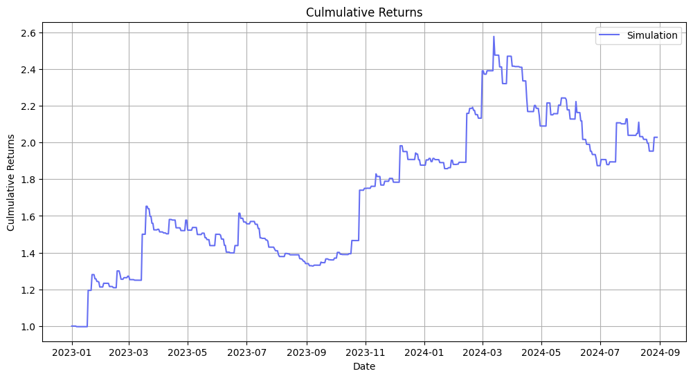
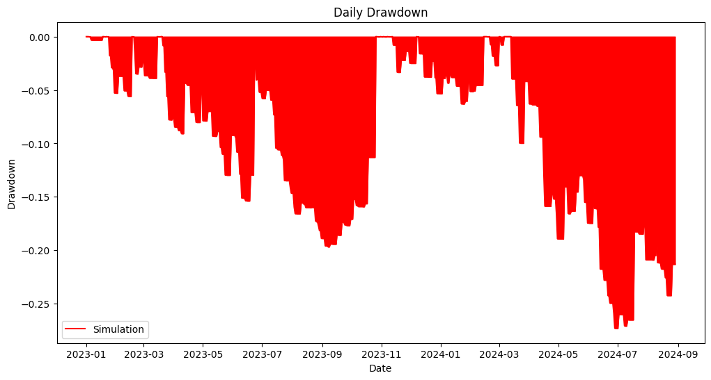
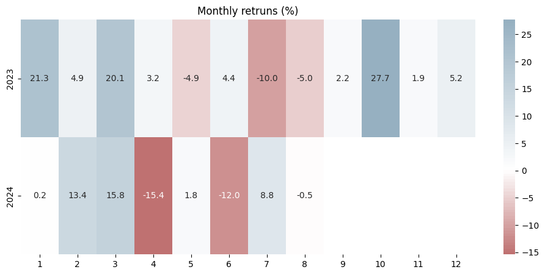
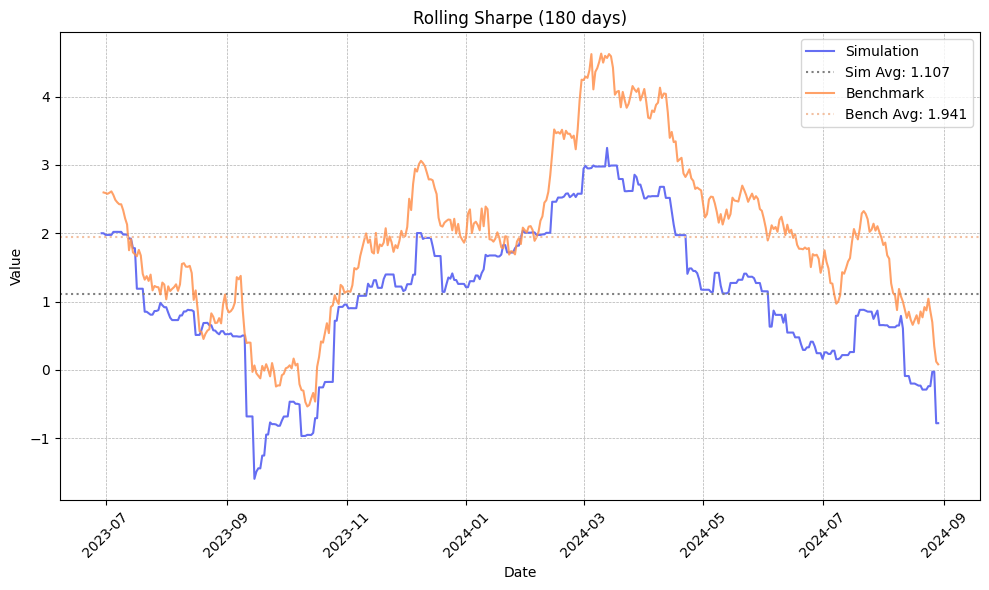

# Overfitting (Futures Backtesting)

[](https://github.com/dohyunkjuly/overfitting/actions/workflows/tests.yml)

Overfitting simulates a realistic crypto futures trading environment including 
- **Liquidation**, **Margin**, **Leverage** for stress testing
- **Multiple Currency** Trading (e.g., backtesting BTC PERP & ETH PERP at the same time)
- Four Different Order Types: LIMIT, MARKET, STOP_LIMIT, STOP_MARKET
- Slippage/Commission Setting

## Installation
    $ pip install overfitting

## Usage
Run from the repository root; the example reads the sample data in `examples/data/`.

```python
import pandas as pd
from overfitting import Strategy
from overfitting.indicators import SMA

def load_data():
    df = pd.read_csv('examples/data/BTCUSDT.csv')
    benchamrk_df = pd.read_csv('examples/data/BTCUSDT.csv') # BTC buy and Hold
    df['timestamp'] = pd.to_datetime(df['timestamp'], unit='ms')
    df.set_index('timestamp', inplace=True)

    start_time = pd.to_datetime('2023-01-01 00:00:00')
    df = df.loc[start_time:]

    return df, benchamrk_df

class MyStrategy(Strategy):
    def init(self):
        self.asset = 'BTC'
        self.set_leverage(self.asset, 1)

        self.sma_short = self.indicator(SMA, self.asset, window=20)
        self.sma_long = self.indicator(SMA, self.asset, window=50)

    def next(self, i):
        if i == 0:
            return

        sma_short = self.sma_short[i]
        sma_long = self.sma_long[i]
        previous_sma_short = self.sma_short[i - 1]
        previous_sma_long = self.sma_long[i - 1]

        if (
            pd.isna(sma_short) or pd.isna(sma_long) or
            pd.isna(previous_sma_short) or pd.isna(previous_sma_long)
        ):
            return

        position = self.get_position(self.asset)

        # Golden cross (entry)
        if previous_sma_short <= previous_sma_long and sma_short > sma_long and position.qty == 0:
            open_price = self.open(self.asset, i)
            lot_size = self.get_balance() // open_price
            self.limit_order(self.asset, lot_size, open_price)

        # Death cross (exit)
        if previous_sma_short >= previous_sma_long and sma_short < sma_long and position.qty > 0:
            self.market_order(self.asset, -position.qty)

price_df, benchmark_data = load_data()
strategy = MyStrategy(
    data={"BTC": price_df},
    benchmark=benchmark_data, # Default = None Optional
    initial_capital=100_000, # Default Optional
    commission_rate=0.0002, # Default Optional
    maint_margin_rate=0.005, # Default Optional
    maint_amount=50  # Default Optional
)
returns = strategy.run()
strategy.plot(returns)
```

Results
-------
```text
Performance Summary
Number of Years               1.66000000
Start Date           2023-01-01 00:00:00
End Date             2024-08-29 00:00:00
Initial Balance         100,000.00000000
Final Balance           205,328.91120000
CAGR                          0.54238181
Cumulative Return             2.05328911
Sharpe Ratio                  1.47036287
Sortino Ratio                 2.79869052
Max Drawdown                 -0.26533797
Daily Value At Risk          -0.03329469
Skew                          0.72604283
Kurtosis                      2.82598628
Total Trades                182.00000000
Winning Trades               69.00000000
Losing Trades               113.00000000
Win Rate (%)                 37.91208791
Gross Profit            399,044.19246000
Gross Loss             -293,715.28126000
Net Profit              105,328.91120000
Avg Return (%)                0.38834383
Avg Profit (%)                3.54140613
Avg Loss (%)                 -1.53697740
  Net drawdown in %  Peak date Valley date Recovery date Duration
0         26.533797 2024-03-13  2024-06-28           NaT      NaN
1         20.996185 2023-03-17  2023-09-12    2023-10-23      157
2          7.051091 2023-12-05  2024-01-22    2024-02-09       49
3          5.980692 2023-01-21  2023-02-13    2023-02-15       18
4          5.578214 2023-02-15  2023-03-07    2023-03-12       18
5          5.550106 2024-03-04  2024-03-06    2024-03-11        6
6          4.538401 2023-11-10  2023-11-16    2023-12-04       17
7          2.530832 2023-11-01  2023-11-03    2023-11-09        7
8          2.162228 2024-02-18  2024-02-23    2024-02-27        7
9          1.603446 2024-02-28  2024-02-29    2024-03-04        4
```

## Performance Visualizations Examples






## Liquidation Handling

The liquidation logic is based on **isolated margin mode**:

- **Initial Margin** = Entry Price × Quantity / Leverage  
- **Maintenance Margin** = Entry Price × Quantity × Maintenance Margin Rate − Maintenance Amount  
- **Liquidation Price** is then calculated based on whether the position is long or short.
    - Long Position Liquidation Price => Entry Price - (Initial Margin - Maintenance Margin)
    - Short Position Liquidation Price => Entry Price + (Initial Margin - Maintenance Margin)

When the price crosses the calculated liquidation level, the position is force-closed and the **entire initial margin is lost**. Nothing more is charged on top, so an isolated position can never lose more than the margin posted for it. Liquidations are marked in the trade log with `is_liquidation_order = True`.

## Margin Check

An order that opens or increases a position needs `price × quantity / leverage` of free margin, where free margin is the cash balance minus the margin locked in open positions.

- If the account cannot afford the order when it is placed, `InsufficientMargin` is raised.
- If the account can no longer afford a resting order when it fills, the order is dropped and listed in `strategy.fetch_rejected_orders()`.
- Orders that reduce or close a position are always accepted.

## Equity Curve

`strategy.run()` returns are based on **equity**: cash plus the unrealized PnL of open positions, marked at each bar's close. Drawdown and Sharpe therefore include losses on positions that are still open.

```python
returns = strategy.run()                       # mark-to-market (default)
returns = strategy.run(mark_to_market=False)   # realized only: moves when trades close

strategy.equity_curve        # cash + unrealized PnL per bar
strategy.realized_balances   # cash per bar
```

## Funding Rate

Add a `funding_rate` column to a symbol's DataFrame to simulate funding. A non-zero value on a bar means funding is settled at that bar's open, on the position held into it:

    payment = -position quantity × open price × funding rate

Longs pay and shorts receive when the rate is positive. Bars with `0` or `NaN` settle nothing. Payments change the cash balance and are listed in `strategy.fetch_funding()`.

## Supported Order Types
Supports four order types: LIMIT, MARKET, STOP LIMIT, and STOP MARKET. Each behaves according to standard trading conventions.

[NOTE] Rules
- For MAKRET Orders, the system will automatically execute the trade with "open" price.
- For STOP Orders, the system will automatically trigger the order when:
    - Long: Price (High) >= Stop Price
    - Short: Price (Low) <= Stop Price
- **Stop Order Immediate Rejection Rule**: If a STOP LIMIT or STOP MARKET order would trigger immediately upon creation (because the current price already breaches the stop price), the system rejects the order with "STOP order would Immediately Trigger" message.
 
```python
limit_order(symbol: str, qty: float, price: float)
market_order(symbol: str, qty: float)
stop_limit_order(symbol: str, qty: float, price: float, stop_price: float)
stop_market_order(symbol: str, qty: float, stop_price: float)
```

## Multiple Currency Backtesting
You can simply test multiple currencies by passing data as dict[str, pd.DataFrame]. For examples, please refer to "multi_currency_sma_corss.ipynb" under "examples" folder.

## Upcoming Features

- **Parameter Optimizer**  
  A simple optimizer to help find the best-performing strategy parameters (like SMA windows, thresholds, etc.) based on backtest results.

> 💡 Got feedback or suggestions? Feel free to open an issue or contribute via pull request.