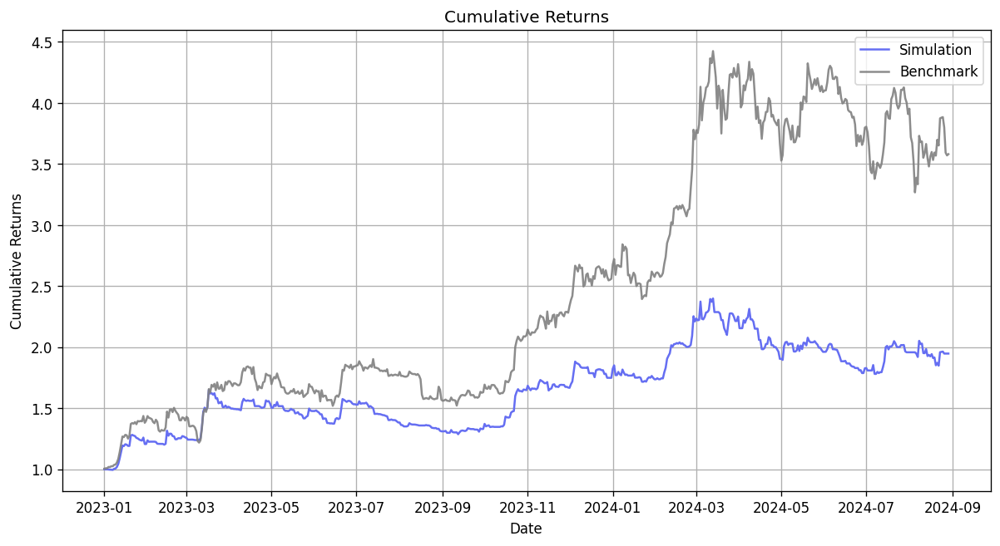
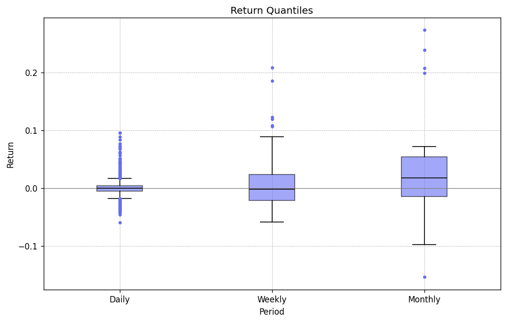
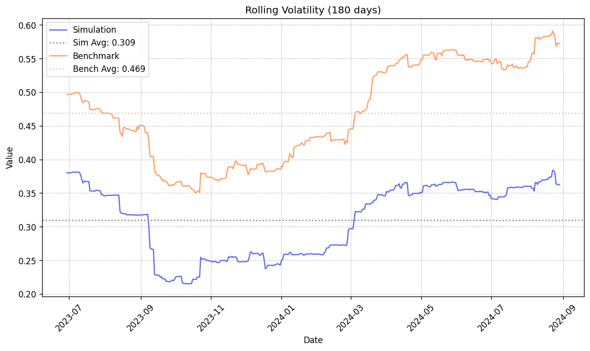
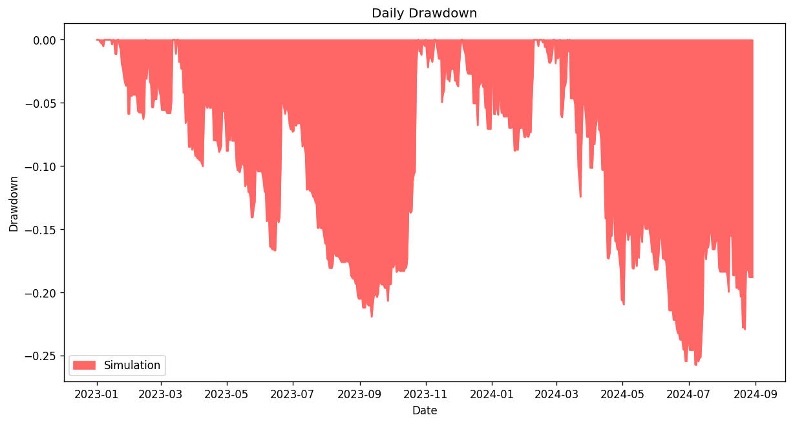
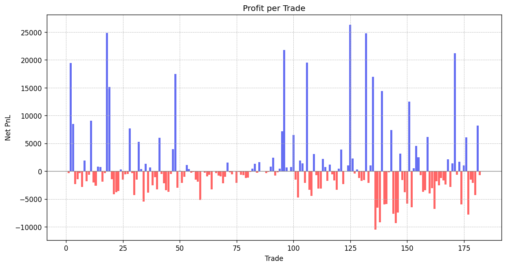

# Overfitting (Futures Backtesting)

[](https://github.com/dohyunkjuly/overfitting/actions/workflows/tests.yml)

For backtesting crypto perpetual futures strategies.

- **Liquidation, margin and leverage**, using isolated margin
- **Several symbols in one backtest**, e.g. BTC and ETH perpetuals together
- **Four order types**: limit, market, stop-limit and stop-market
- **Commission, slippage and funding rates**
- **Market data from 19 exchanges**, downloaded once and kept on your machine
- **A parameter optimizer** that runs in parallel
- **A full performance report**: a printed summary and 13 charts

## Installation

    $ pip install overfitting

## Contents

- [Quick Start](#quick-start)
- [Market Data](#market-data)
- [Writing a Strategy](#writing-a-strategy)
- [How the Simulation Works](#how-the-simulation-works)
- [Report and Charts](#report-and-charts)
- [Trade and Account Data](#trade-and-account-data)
- [Parameter Optimization](#parameter-optimization)

## Quick Start

Run from the repository root; the example reads the sample data in `examples/data/`.

```python
import pandas as pd
from overfitting import Strategy
from overfitting.indicators import sma, crossover, crossunder

def load_data():
    df = pd.read_csv('examples/data/BTCUSDT.csv')
    df['timestamp'] = pd.to_datetime(df['timestamp'], unit='ms')
    df = df.set_index('timestamp')

    # Funding rates are paid every 8 hours; every other bar gets 0
    funding = pd.read_csv('examples/data/BTCUSDT_funding.csv')
    funding['timestamp'] = pd.to_datetime(funding['timestamp'], unit='ms')
    df['funding_rate'] = funding.set_index('timestamp')['funding_rate'].reindex(df.index, fill_value=0)

    benchmark_df = pd.read_csv('examples/data/BTCUSDT.csv')  # BTC buy and hold
    return df, benchmark_df

class MyStrategy(Strategy):
    def init(self):
        self.asset = 'BTC'
        self.set_leverage(self.asset, 1)

        close = self.data[self.asset].close
        self.fast = self.I(sma, close, 20)
        self.slow = self.I(sma, close, 50)

    def next(self):
        position = self.get_position(self.asset)

        # Golden cross (entry)
        if crossover(self.fast, self.slow) and position.qty == 0:
            price = self.price(self.asset)
            lot_size = self.get_balance() // price
            self.limit_order(self.asset, lot_size, price)

        # Death cross (exit)
        elif crossunder(self.fast, self.slow) and position.qty > 0:
            self.market_order(self.asset, -position.qty)

price_df, benchmark_data = load_data()
strategy = MyStrategy(
    data={"BTC": price_df},
    benchmark=benchmark_data,
    initial_capital=100_000,
    commission_rate=0.0002,
    maint_margin_rate=0.005,
    maint_amount=50,
    funding=True,
)
returns = strategy.run()
strategy.plot(returns)
```

A strategy is a class with two methods: `init()` runs once before the first bar, and `next()` runs on every bar. `MyStrategy(...)` takes:

| Argument | Default | Meaning |
|---|---|---|
| `data` | required | `{name: DataFrame}` with `open`, `high`, `low`, `close` and `volume` columns, and a `timestamp` column or a datetime index. `load()` returns this format |
| `benchmark` | `None` | Price data (a `close` column) to compare against in the report, e.g. buy and hold |
| `initial_capital` | `100000` | Starting cash, in the quote currency of the data (USDT for BTC/USDT). Every money value in the results is in this currency |
| `commission_rate` | `0.0002` | Fee on each fill, as a share of its value (0.02%) |
| `maint_margin_rate` | `0.005` | Maintenance margin rate, used for the liquidation price |
| `maint_amount` | `0` | Maintenance amount subtracted from the maintenance margin, as exchanges list it per tier |
| `slippage` | `None` | A number like `0.001` (each fill 0.1% worse) or a slippage model; see [Slippage](#slippage) |
| `params` | `None` | Values for the strategy's parameters, e.g. `{"fast": 10}`; see [Parameter Optimization](#parameter-optimization) |
| `record` | `True` | `False` skips the per-bar history for a faster run; returns are the same |
| `funding` | `False` | `True` settles funding from the `funding_rate` column; see [Funding Rate](#funding-rate) |

`strategy.run()` returns the returns per bar, and `strategy.plot(returns)` prints the summary below and shows the 13 charts after it.

### Results

```text
Performance Summary

Overview
  Start Date                                   2023-01-01 00:00
  End Date                                     2024-08-29 00:00
  Number of Years                                         1.663
  Initial Balance                                    100,000.00
  Final Balance                                      194,771.96
  Total Return                                           94.77%
  CAGR                                                   49.31%

Returns
  Best Day                                                9.51%
  Worst Day                                              -5.94%
  Best Month                                             27.29%
  Worst Month                                           -15.41%
  Positive Days                                          34.76%
  Positive Months                                        65.00%
  Average Up Day                                          1.58%
  Average Down Day                                       -0.96%
  Longest Winning Streak (days)                               7
  Longest Losing Streak (days)                                7

Risk
  Volatility (annualized)                                33.29%
  Downside Deviation (annualized)                        17.81%
  Sharpe Ratio                                            1.368
  Sortino Ratio                                           2.557
  Calmar Ratio                                            1.915
  Omega Ratio                                             1.293
  Gain to Pain Ratio                                      0.293
  Tail Ratio                                              1.432
  Common Sense Ratio                                      1.851
  Daily Value at Risk (95%)                              -2.21%
  Daily Expected Shortfall (95%)                         -3.30%
  Skew (daily)                                            1.696
  Excess Kurtosis (daily)                                 7.157

Drawdown
  Max Drawdown                                          -25.75%
  Current Drawdown                                      -18.80%
  Average Drawdown                                       -5.09%
  Longest Drawdown (days)                                   221
  Time Underwater                                        93.74%
  Ulcer Index                                            12.64%
  Recovery Factor                                         3.680

Sharpe Ratio Reliability
  Sharpe 95% Range                                -0.07 to 2.80
  Probability Sharpe Above 0                             96.91%

Benchmark
  Alpha (annualized)                                      0.00%
  Beta                                                    0.513
  Correlation                                             0.758
  Tracking Error (annualized)                            32.32%
  Information Ratio                                      -1.337
  Excess Return (annualized)                            -66.03%
  Up Capture                                              0.491
  Down Capture                                            0.487

Trades
  Total Trades                                              182
  Long Trades                                               182
  Short Trades                                                0
  Win Rate                                               36.26%
  Win Rate (long)                                        36.26%
  Win Rate (short)                                          n/a
  Average Win                                          5,616.32
  Average Loss                                        -2,378.49
  Largest Win                                         26,267.52
  Largest Loss                                       -10,531.00
  Payoff Ratio                                            2.361
  Profit Factor                                           1.343
  Expectancy per Trade                                   520.73
  Average Holding Time (bars)                            43.352
  Average Holding Time, Winners (bars)                   74.076
  Average Holding Time, Losers (bars)                    25.871
  Longest Winning Streak (trades)                             4
  Longest Losing Streak (trades)                             10
  Trades per Month                                        9.233
  Profit From Best Trade                                 27.72%
  Net Profit Without Best 5 Trades                   -24,052.18
  Gross Profit                                       370,677.31
  Gross Loss                                        -275,905.34
  Net Profit                                          94,771.96

Trade Quality
  Average Adverse Excursion                              -1.85%
  Average Favourable Excursion                            3.08%
  Liquidations                                                0

Costs
  Total Commission                                    10,689.43
  Total Slippage                                           0.00
  Funding Paid                                        16,533.80
  Funding Received                                       360.10
  Total Costs                                         26,863.14
  Profit Before Costs                                121,635.10
  Costs as Share of Profit Before Costs                  22.09%
  Traded Value                                    53,447,149.50
  Turnover (times equity per year)                      193.623

Exposure and Margin
  Time in Market                                         54.25%
  Average Leverage                                        0.487
  Average Leverage in Market                              0.898
  Maximum Leverage                                        1.001
  Average Margin Usage                                   47.59%
  Peak Margin Usage                                     101.06%
  Closest Distance to Liquidation                        99.50%

Orders
  Orders Placed                                             364
  Orders Filled                                             364
  Orders Cancelled                                            0
  Orders Rejected                                             0
  Orders Still Open                                           0
  Fill Rate                                             100.00%
  Average Slippage per Fill                               0.00%

By Symbol
       Trades Win rate    Net PnL Average PnL Profit factor Share of profit Time held
Symbol
BTC       182    36.3%  94,771.96      520.73          1.34          100.0%     54.2%

Worst Drawdowns
   Net drawdown in %  Peak date Valley date Recovery date  Duration (days)
0          25.753683 2024-03-13  2024-07-08           NaT              169
1          21.944019 2023-03-17  2023-09-12    2023-10-25              221
2           8.777934 2023-12-05  2024-01-22    2024-02-09               65
3           6.286733 2023-01-21  2023-02-13    2023-02-15               24
4           6.144841 2024-03-04  2024-03-06    2024-03-11                6
5           5.828858 2023-02-15  2023-03-07    2023-03-12               24
6           4.959508 2023-11-10  2023-11-16    2023-12-04               23
7           2.192422 2023-11-01  2023-11-03    2023-11-09                7
8           1.879171 2024-02-28  2024-02-29    2024-03-04                4
9           1.823384 2024-02-18  2024-02-23    2024-02-27                8
```












## Market Data

`load()` downloads candles (and, if asked, funding rates) from an exchange, saves them on your machine, and returns them ready for a backtest. Later calls read from the local copy and only download what is missing, such as bars that have closed since.

```python
from overfitting import Strategy
from overfitting.market import load

data = load(["BTC/USDT", "ETH/USDT"], "1h", start="2023-01-01", exchange="binance", funding=True)
strategy = MyStrategy(data, funding=True)
```

```text
Downloading binance BTC/USDT 1h candles 2023-01-01 00:00 to 2026-11-18 21:00
  34,029 bars saved
Downloading binance BTC/USDT funding rates 2023-01-01 00:00 to 2026-11-18 21:00
  4,254 funding payments saved
Downloading binance ETH/USDT 1h candles 2023-01-01 00:00 to 2026-11-18 21:00
  34,029 bars saved
Downloading binance ETH/USDT funding rates 2023-01-01 00:00 to 2026-11-18 21:00
  4,254 funding payments saved
```

Each symbol comes back as a DataFrame with `open`, `high`, `low`, `close`, `volume` and, with `funding=True`, `funding_rate` (the rate paid at that bar's open, 0 on other bars), indexed by bar open time in UTC. Only bars that have closed are returned.

| Argument | Meaning |
|---|---|
| `symbols` | `"BTC/USDT"` or a list, written BASE/QUOTE as in ccxt. The result is keyed the same way: `data["BTC/USDT"]` |
| `timeframe` | `1m`, `3m`, `5m`, `15m`, `30m`, `1h`, `2h`, `4h`, `6h`, `12h`, `1d` |
| `start`, `end` | Dates such as `"2023-01-01"`, in UTC. `end` defaults to now |
| `exchange` | Any of the 19 below (default `"binance"`) |
| `funding` | Also download funding rates and add the `funding_rate` column (default `False`) |
| `data_dir` | Where the data is kept. Default `~/.overfitting/data`, or the `OVERFITTING_DATA_DIR` environment variable |

**Exchanges.** Each serves its own linear perpetuals, quoted in the currency shown: `load("BTC/USDC", exchange="hyperliquid")`, `load("BTC/USD", exchange="dydx")`. Asking for the wrong quote raises an error that names the right one. History is how far back the exchange serves data today; data you download is kept, so the local store can hold more.

| `exchange` | Quote | Timeframes | Candle history | Funding |
|---|---|---|---|---|
| `binance` | USDT | all | full | full |
| `aster` | USDT | all | from 2021 | full |
| `bingx` | USDT | 1m 30m 1h 2h 4h 6h 12h 1d | 1m about a year, 1h from 2024, 2h+ from 2022 | none |
| `bitfinex` | USDT | 1m 5m 15m 30m 1h 6h 12h 1d | from 2019; minutes without trades have no bar | full (from snapshots) |
| `bitget` | USDT | all but 2h | from 2019 | none |
| `blofin` | USDT | all | from 2023 | full |
| `bybit` | USDT | all | full | full |
| `cryptocom` | USD | all but 3m | from 2021 | full, hourly |
| `deribit` | USDC | 1m to 2h | from 2022 | full, hourly |
| `dydx` | USD | 1m 5m 15m 30m 1h 4h 1d | from October 2023 | full, hourly |
| `gate` | USDT | all | latest 10,000 bars (1m: about a week) | last 180 days |
| `htx` | USDT | 1m 5m 15m 30m 1h 4h | from 2021 | none |
| `hyperliquid` | USDC | all but 6h | latest ~5,000 bars (1m: about 3.5 days, 1h: about 7 months) | from 2023, hourly |
| `kraken` | USD | 1m 5m 15m 30m 1h 4h 12h 1d | from 2022 | last year, hourly |
| `kucoin` | USDT | all but 3m and 6h | 1m from late 2024, 1h from mid 2024, 1d from 2020 | full |
| `mexc` | USDT | 1m 5m 15m 30m 1h 4h 1d | 1m about 30 days, 30m+ from 2020 | none |
| `okx` | USDT | all | full | about 3 months |
| `phemex` | USDT | all | from 2022 | full |
| `woo` | USDT | all | 1m and 1h+ from 2022; 3m to 30m kept for a limited time | full |

Where an exchange has no funding history, `funding_rate` is 0 and `load()` warns. It also warns when data starts later than the requested start, and when the exchange is missing bars.

- The data is kept as Parquet files outside your project and virtual environment, so every project on the machine shares it: `binance/candles/1m/BTC-USDT/2024-01.parquet` (one file per month below 1h, per year above). A year of 1-minute bars is about 15 MB and loads in a few hundredths of a second.
- With several symbols, only the bars all of them have are kept, so their timelines match. A symbol listed later trims the others, with a warning.
- Gaps in the exchange's own data, and funding history that starts later than the candles (OKX only serves recent funding), are reported as warnings.
- An interrupted download resumes where it stopped.
- A catalog (`catalog.sqlite` in the same folder) records what has been downloaded and logs every change. `overfitting.market.stored()` lists what is saved; `overfitting.market.downloads()` shows the log.
- Files deleted by hand are downloaded again on the next `load()`. Parquet files you put in the folder yourself (named like the others, with columns `time`, `open`, `high`, `low`, `close`, `volume`) are checked and used instead of downloading. A file that fails the checks is renamed to `*.invalid` with a warning.

## Writing a Strategy

### Indicators

An indicator is a plain function that takes price series and returns one value per bar. Declare it in `init()` with `self.I`, then read it in `next()` relative to the current bar:

```python
from overfitting.indicators import sma, rsi, bollinger, crossover

def init(self):
    bars = self.data["BTC"]
    self.fast = self.I(sma, bars.close, 20)
    self.rsi = self.I(rsi, bars.close, 14)
    self.bands = self.I(bollinger, bars.close, 20, 2)    # several outputs

def next(self):
    self.fast[-1]            # value at the last completed bar
    self.fast[-2]            # the bar before
    self.bands.upper[-1]     # one output of a multi-output indicator
    crossover(self.rsi, 30)  # True when RSI just moved above 30
```

- Inside `next()`, an indicator only shows bars that have finished. The bar being traded and later bars cannot be read, so there is no look-ahead to guard against.
- Before there is enough history the value is `NaN`, and `crossover` / `crossunder` return `False`.
- `self.price("BTC")` is the open of the current bar, the price a market order placed now fills at.
- Built in: `sma`, `ema`, `wma`, `rsi`, `macd`, `stochastic`, `bollinger`, `atr`, `donchian`.
- A custom indicator is any function of the same shape; see `examples/donchian_breakout.py`.

`next(self, i)` with the bar index is also supported.

### Placing Orders

```python
self.limit_order(symbol, qty, price)
self.market_order(symbol, qty)
self.stop_limit_order(symbol, qty, price, stop_price)
self.stop_market_order(symbol, qty, stop_price)
```

`qty` is positive to buy and negative to sell. Each returns the order, and each takes an optional `label` that shows up in the trade log.

- A market order fills at the open of the current bar.
- A limit order fills when the price trades through its limit. One placed when the open is already better than the limit fills at the open.
- A stop order triggers when the high reaches the stop price (buys) or the low reaches it (sells).
- A triggered stop-market order fills at the stop price, or at the open if the bar opened past it.
- A triggered stop-limit order becomes a limit order at that price. If the limit leaves room (a buy limit at or above it, a sell limit at or below it), it fills there at once; otherwise it waits for the price to trade through the limit.
- A stop order that would trigger the moment it is placed, because the price is already past its stop, is rejected with `StopOrderRejected`.

### Account and Position

| Method | Returns or does |
|---|---|
| `get_position(symbol)` | The position: `qty`, entry `price`, `margin`, `liquid_price`, `leverage` |
| `get_balance()` | Cash, without unrealized PnL |
| `get_equity()` | Cash plus the unrealized PnL of open positions |
| `get_available_margin()` | Cash not locked as margin |
| `get_open_orders(symbol)` | Open orders, as `{order id: order}` |
| `set_leverage(symbol, leverage)` | Leverage from 1 to 100 |
| `cancel_order(symbol, order_id)`, `cancel_all_orders(symbol)` | Cancel open orders |
| `close_all_positions(symbol)` | Close the position with a market order |
| `price(symbol)` | The open of the current bar, the price a market order placed now fills at |

### Multiple Symbols

Pass one DataFrame per symbol: `MyStrategy({"BTC": btc_df, "ETH": eth_df})`. They must cover the same timestamps; `load()` lines them up for you. See `examples/multi_currency_sma_cross.ipynb`.

## How the Simulation Works

### Margin Check

An order that opens or increases a position needs `price × quantity / leverage` of free margin, where free margin is the cash balance minus the margin locked in open positions.

- If the account cannot afford the order when it is placed, `InsufficientMargin` is raised.
- If the account can no longer afford a resting order when it fills, the order is dropped and listed in `strategy.fetch_rejected_orders()`.
- Orders that reduce or close a position are always accepted.

### Liquidation

The liquidation logic is based on **isolated margin mode**:

- **Initial Margin** = Entry Price × Quantity / Leverage
- **Maintenance Margin** = Entry Price × Quantity × Maintenance Margin Rate − Maintenance Amount
- **Liquidation Price** is then calculated based on whether the position is long or short.
    - Long Position Liquidation Price => Entry Price - (Initial Margin - Maintenance Margin)
    - Short Position Liquidation Price => Entry Price + (Initial Margin - Maintenance Margin)

When the price crosses the calculated liquidation level, the position is force-closed and the **entire initial margin is lost**. Nothing more is charged on top, so an isolated position can never lose more than the margin posted for it. Liquidations are marked in the trade log with `is_liquidation_order = True`.

### Funding Rate

Funding is off by default. To simulate it, give a symbol's DataFrame a `funding_rate` column (`load(..., funding=True)` adds one) and pass `funding=True` to the strategy:

```python
strategy = MyStrategy(data, funding=True)
```

A non-zero value on a bar means funding is settled at that bar's open, on the position held into it:

    payment = -position quantity × open price × funding rate

Longs pay and shorts receive when the rate is positive. Bars with `0` or `NaN` settle nothing. Payments change the cash balance and are listed in `strategy.fetch_funding()`.

### Slippage

```python
MyStrategy(data, slippage=0.001)             # every fill is 0.1% worse than the order price

from overfitting.slippage import skewed
MyStrategy(data, slippage=skewed(0.15))      # slips 15% of the way from the open to the bar's extreme

MyStrategy(data, slippage=lambda order, bar: order.theoretical_price + 0.5)   # your own model
```

A slippage model is a function `(order, bar) -> executed price`. `order.qty` is positive for a buy, and `bar` has `open`, `high`, `low` and `close`.

### Equity Curve

`strategy.run()` returns are based on **equity**: cash plus the unrealized PnL of open positions, marked at each bar's close. Drawdown and Sharpe therefore include losses on positions that are still open.

```python
returns = strategy.run()                       # mark-to-market (default)
returns = strategy.run(mark_to_market=False)   # realized only: moves when trades close

strategy.equity_curve        # cash + unrealized PnL per bar
strategy.realized_balances   # cash per bar
```

## Report and Charts

`strategy.plot(returns)` prints a performance summary and shows 13 charts. The [Quick Start](#results) shows the full output.

The summary has eleven sections: overview, returns, risk, drawdown, Sharpe ratio reliability, benchmark, trades, trade quality, costs, exposure and margin, and orders, followed by a per-symbol table and the worst drawdowns.

```python
strategy.plot(returns)                         # print the summary and show the charts
strategy.plot(returns, save_path="results")    # also save each chart as a PNG in results/
strategy.plot(returns, title="SMA cross")      # name used on the charts
```

| Chart | Function in `overfitting.analysis.plots` | Needs |
|---|---|---|
| Cumulative returns | `cumulative_returns` | |
| Cumulative returns, log scale | `cumulative_returns_log` | |
| Monthly returns heatmap | `monthly_heatmap` | |
| Yearly returns | `yearly_returns` | |
| Distribution of monthly returns | `monthly_distribution` | |
| Return quantiles (box plot of daily, weekly, monthly returns) | `return_quantiles` | |
| Rolling Sharpe | `rolling_sharpe` | |
| Rolling volatility | `rolling_volatility` | |
| Drawdown | `drawdown` | |
| Rolling beta | `rolling_beta` | a benchmark |
| Profit per trade | `profit_per_trade` | |
| Cost breakdown | `cost_breakdown` | |
| Distance to liquidation | `liquidation_distance` | |

Rolling beta is skipped when no benchmark is given. Each chart is also available on its own, and every number behind them is in `overfitting.analysis.metrics`:

```python
from overfitting.analysis import metrics, plots

daily = metrics.aggregate_returns(returns, "D")
plots.drawdown(daily).savefig("drawdown.png")
plots.profit_per_trade(strategy.fetch_round_trips())
metrics.summary(daily)       # 49 metrics as a pandas Series

metrics.trade_summary(strategy.fetch_round_trips())   # win rate, expectancy, streaks ...
metrics.by_symbol(strategy.fetch_round_trips())       # results per symbol
metrics.by_weekday(strategy.fetch_round_trips())      # results by entry weekday
```

## Trade and Account Data

After `strategy.run()`, everything that happened is available as pandas DataFrames:

```python
strategy.fetch_round_trips()            # one row per completed trade
strategy.fetch_trades()                 # one row per fill
strategy.fetch_orders()                 # every order placed, with its status
strategy.fetch_account_history()        # the account on every bar
strategy.fetch_position_history("BTC")  # one symbol's position on every bar
strategy.fetch_funding()                # funding payments
```

The examples below are from the [Quick Start](#quick-start). Wide tables show their main columns; every column is listed under each one.

### Round trips

A round trip runs from opening a position until it is flat again or flips sides.

```text
  symbol  side          entry_time           exit_time  qty  entry_price  exit_price     net_pnl  return_pct     mae     mfe
0    BTC  LONG 2023-01-04 07:00:00 2023-01-06 02:00:00  5.0      16872.8     16818.1   -333.3073     -0.0040 -0.0078  0.0066
1    BTC  LONG 2023-01-07 01:00:00 2023-01-18 19:00:00  5.0      16969.9     20933.3  19467.0870      0.2294 -0.0041  0.2771
2    BTC  LONG 2023-01-20 08:00:00 2023-01-22 23:00:00  5.0      20954.1     22674.1   8477.4236      0.0809 -0.0028  0.1162
```

Columns: `symbol`, `side`, `entry_time`, `exit_time`, `bars_held`, `duration`, `qty`, `entry_price`, `exit_price`, `pnl`, `commission`, `funding`, `net_pnl`, `return_pct`, `mae`, `mfe`, `fills`, `entry_label`, `exit_label`, `is_liquidation`.

- `pnl` is before costs; `net_pnl` is after commission and funding.
- `return_pct` is `net_pnl` as a share of the entry value.
- `mae` and `mfe` are how far the price moved against and in favour of the position while it was open, as a share of the entry price.

A round trip runs from flat to flat, however many fills happen in between. Buying 0.5 BTC, selling 0.25, buying 0.5 and selling 0.75 is one round trip with 4 fills:

- `entry_price` is the average of all buys and `exit_price` the average of all sells, weighted by size.
- `pnl` is the sum of every partial close.
- `qty` is the largest position held, 0.75 here.

`fetch_trades()` still lists each fill separately.

### Fills

```text
          executed_at symbol   side    type  qty  executed_price  commission  realized_pnl
0 2023-01-04 07:00:00    BTC   LONG   LIMIT  5.0         16872.8     16.8728      -16.8728
1 2023-01-06 02:00:00    BTC  SHORT  MARKET -5.0         16818.1     16.8181     -290.3181
2 2023-01-07 01:00:00    BTC   LONG   LIMIT  5.0         16969.9     16.9699      -16.9699
```

### Orders

```text
           created_at symbol    type  qty    price stop_price  status reject_reason
0 2023-01-04 07:00:00    BTC   LIMIT  5.0  16872.8       None  FILLED          None
1 2023-01-06 02:00:00    BTC  MARKET -5.0      NaN       None  FILLED          None
2 2023-01-07 01:00:00    BTC   LIMIT  5.0  16969.9       None  FILLED          None
```

Fills and orders have the same columns: `id`, `created_at`, `executed_at`, `cancelled_at`, `status`, `reject_reason`, `symbol`, `qty`, `side`, `price`, `type`, `stop_price`, `is_triggered`, `is_liquidation_order`, `theoretical_price`, `executed_price`, `slippage`, `commission`, `pnl`, `realized_pnl`, `label`.

- `status` is `OPEN`, `FILLED`, `CANCELLED` or `REJECTED`, with the reason in `reject_reason`.
- `theoretical_price` is the price before slippage, `executed_price` after it, and `slippage` what that cost.
- `pnl` is the profit the fill closed; `realized_pnl` is `pnl` minus commission.
- Orders the account could no longer afford when they filled are also listed in `strategy.fetch_rejected_orders()`.

### Account history

One row per bar, at the bar's close. Here a position opens at 07:00:

```text
                          cash     equity   margin  gross_exposure  net_exposure  leverage
2023-01-04 06:00:00  100000.00  100000.00      0.0             0.0           0.0      0.00
2023-01-04 07:00:00   99983.13   99931.63  84364.0         84312.5       84312.5      0.84
2023-01-04 08:00:00   99980.27   99901.77  84364.0         84285.5       84285.5      0.84
```

- `equity` is cash plus unrealized PnL; `margin` is the margin locked in open positions.
- `gross_exposure` adds longs and shorts; `net_exposure` is longs minus shorts.
- `leverage` is gross exposure over equity.

### Position history

One row per bar for one symbol, at the bar's close:

```text
                     qty  entry_price    close  exposure   margin  liquidation_price  unrealized_pnl
2023-01-04 06:00:00  0.0          NaN  16872.9       0.0      0.0                NaN             0.0
2023-01-04 07:00:00  5.0      16872.8  16862.5   84312.5  84364.0              74.36           -51.5
2023-01-04 08:00:00  5.0      16872.8  16857.1   84285.5  84364.0              74.36           -78.5
```

While flat, `qty` is 0 and the entry and liquidation prices are `NaN`.

### Funding

The first two payments, and the first one received:

```text
                  time symbol  qty    price  funding_rate    amount
0  2023-01-04 08:00:00    BTC  5.0  16862.5      0.000034 -2.856508
1  2023-01-04 16:00:00    BTC  5.0  16846.5      0.000049 -4.153505
12 2023-01-09 08:00:00    BTC  5.0  17189.8     -0.000007  0.572420
```

- Each row is one payment. `price` is the open of the bar it was paid on.
- `amount` is `-qty × price × funding_rate`. A long pays when the rate is positive and gets paid when it is negative.
- Over the whole backtest, this strategy made 991 payments: it paid 16,533.80 and received 360.10.

## Parameter Optimization

A strategy's parameters are its class attributes. `optimize` runs the strategy once for every combination of the values you give and reports the best one:

```python
from overfitting import Strategy, optimize
from overfitting.indicators import sma, crossover, crossunder

class SmaCross(Strategy):
    fast = 20
    slow = 50

    def init(self):
        close = self.data["BTC"].close
        self.fast_ma = self.I(sma, close, self.fast)
        self.slow_ma = self.I(sma, close, self.slow)

    def next(self):
        position = self.get_position("BTC")
        if crossover(self.fast_ma, self.slow_ma) and position.qty == 0:
            price = self.price("BTC")
            self.limit_order("BTC", self.get_balance() // price, price)
        elif crossunder(self.fast_ma, self.slow_ma) and position.qty > 0:
            self.market_order("BTC", -position.qty)

result = optimize(
    SmaCross, {"BTC": price_df},
    params={"fast": range(5, 55, 5), "slow": range(20, 220, 20)},
    maximize="sharpe_ratio",
    constraint=lambda p: p.fast < p.slow,
    train=("2023-01-01", "2024-01-01"),  # search on 2023 only
    slippage=0.001,                      # any Strategy argument can be passed
)
print(result)
```

```text
Optimization of SmaCross
  Trials            90 (grid)
  Maximized         sharpe_ratio
  Trained on        2023-01-01 to 2023-12-31
  Best parameters   fast=45, slow=100

  Full backtest     2023-01-01 to 2024-08-29
  Total Return      141.01%
  CAGR              69.72%
  Volatility        32.08%
  Sharpe Ratio      1.807
  Sortino Ratio     3.403
  Max Drawdown      -15.80%
  Calmar Ratio      4.411
  Fills             158
```

The search runs on the `train` window; the winner is then backtested over all the data.

```python
result.best_params                 # {"fast": 45, "slow": 100}
result.metrics                     # the full backtest's metrics
result.table                       # every combination tried, best first (scored on the training window)
result.heatmap("fast", "slow")     # the metric as a grid of two parameters
result.strategy                    # the winner, run over all the data
result.strategy.plot(result.returns)
```

| Argument | Meaning |
|---|---|
| `maximize` | `total_return`, `cagr`, `volatility`, `sharpe_ratio`, `sortino_ratio`, `max_drawdown`, `calmar_ratio`, `fills`, or a function of those, e.g. `lambda m: m["cagr"] / abs(m["max_drawdown"])` |
| `constraint` | Function returning `False` for combinations to skip |
| `method`, `n`, `seed` | `"grid"` tries everything; `"random"` tries `n` combinations |
| `train` | The data the search uses: a share of the most recent data, e.g. `0.6`, or a date range `("2024-01-01", "2025-01-01")` (end not included). Default `1.0`, all of it |
| `workers` | Processes to use. Default is all cores; `1` runs in the current process |

Combinations run in parallel on macOS and Linux. On the example above, 1,000 combinations of 14,500 hourly bars take about 6 seconds on a 10-core laptop.

For a full walkthrough (grid and random search, a custom objective, the heatmap, and the winner's report), see `examples/optimize_sma_cross.ipynb`.
