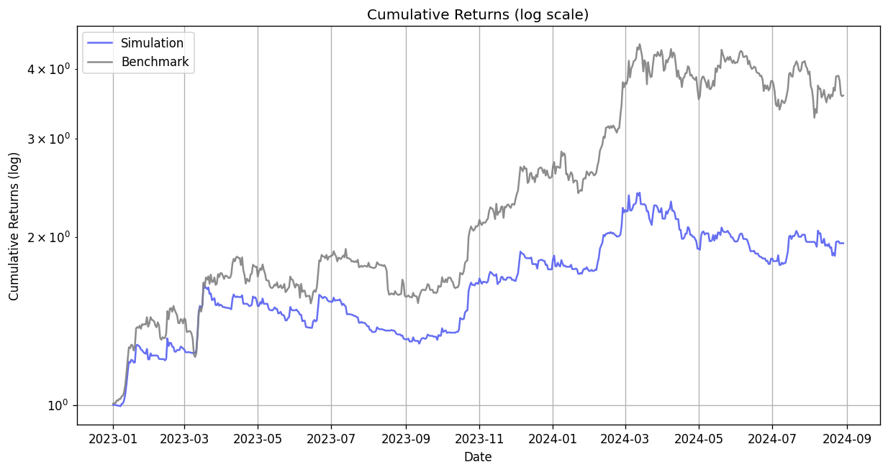
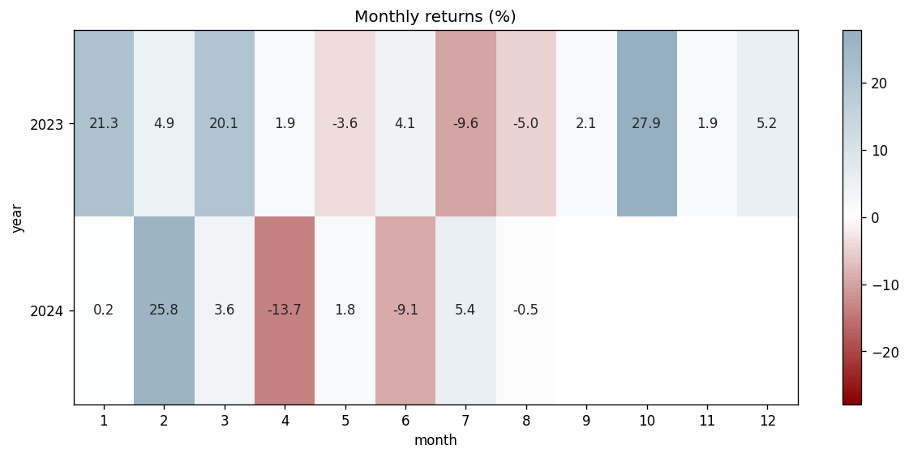
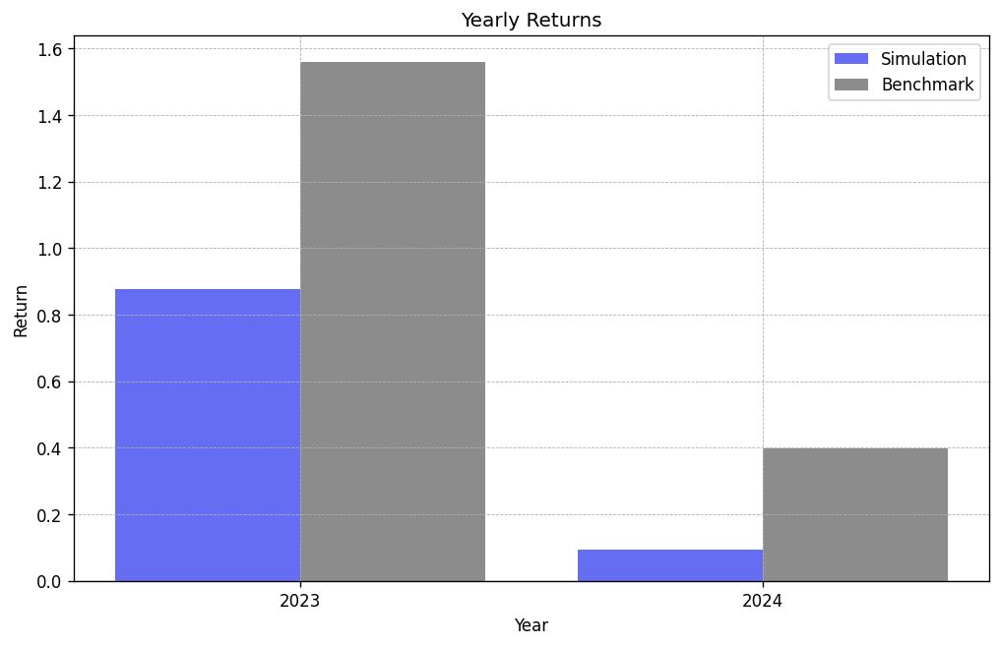
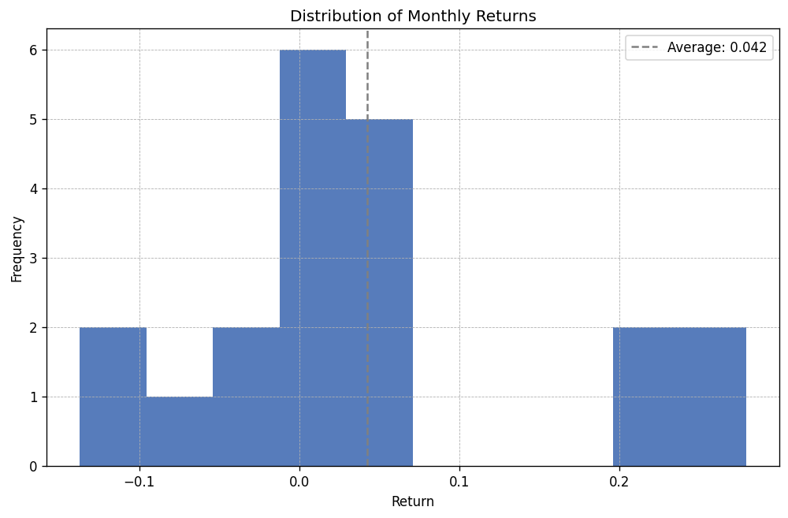
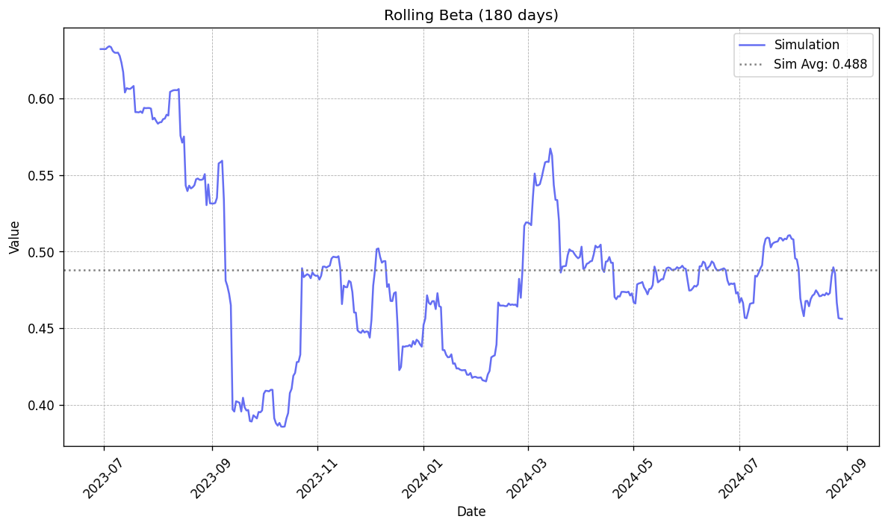
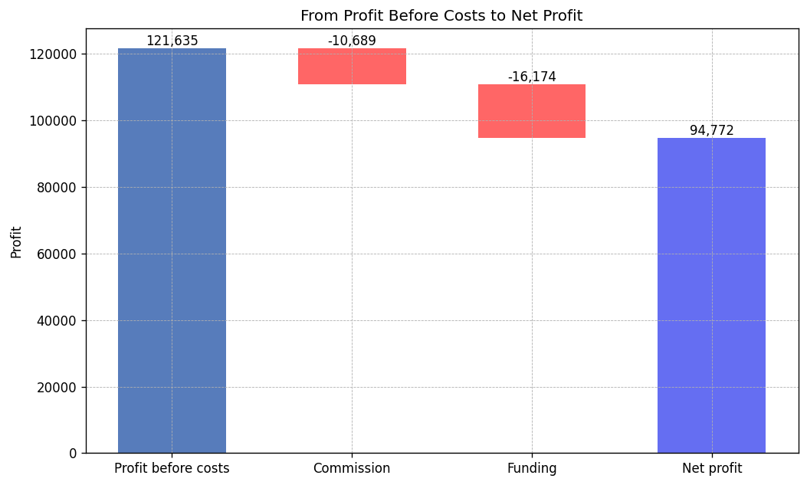
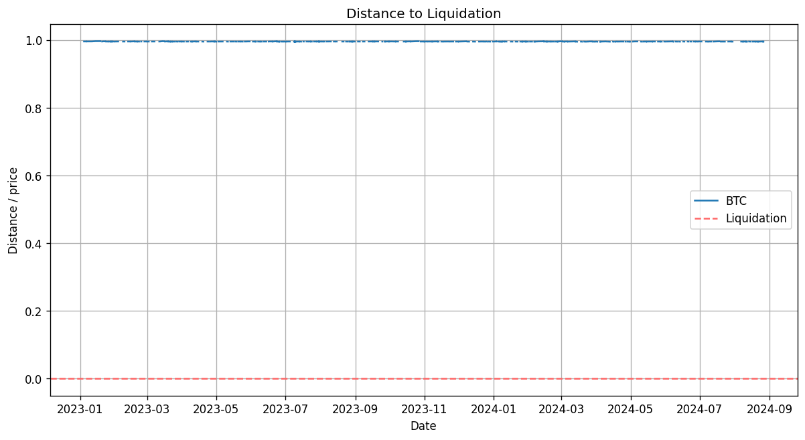

# Overfitting (Futures Backtesting)

[](https://github.com/dohyunkjuly/overfitting/actions/workflows/tests.yml)

Overfitting simulates a realistic crypto futures trading environment including 
- **Liquidation**, **Margin**, **Leverage** for stress testing
- **Multiple Currency** Trading (e.g., backtesting BTC PERP & ETH PERP at the same time)
- Four Different Order Types: LIMIT, MARKET, STOP_LIMIT, STOP_MARKET
- Slippage/Commission Setting

## Installation
    $ pip install overfitting

## Usage
Run from the repository root; the example reads the sample data in `examples/data/`.

```python
import pandas as pd
from overfitting import Strategy
from overfitting.indicators import sma, crossover, crossunder

def load_data():
    df = pd.read_csv('examples/data/BTCUSDT.csv')
    benchamrk_df = pd.read_csv('examples/data/BTCUSDT.csv') # BTC buy and Hold
    df['timestamp'] = pd.to_datetime(df['timestamp'], unit='ms')
    df.set_index('timestamp', inplace=True)

    start_time = pd.to_datetime('2023-01-01 00:00:00')
    df = df.loc[start_time:]

    return df, benchamrk_df

class MyStrategy(Strategy):
    def init(self):
        self.asset = 'BTC'
        self.set_leverage(self.asset, 1)

        close = self.data[self.asset].close
        self.fast = self.I(sma, close, 20)
        self.slow = self.I(sma, close, 50)

    def next(self):
        position = self.get_position(self.asset)

        # Golden cross (entry)
        if crossover(self.fast, self.slow) and position.qty == 0:
            price = self.price(self.asset)
            lot_size = self.get_balance() // price
            self.limit_order(self.asset, lot_size, price)

        # Death cross (exit)
        elif crossunder(self.fast, self.slow) and position.qty > 0:
            self.market_order(self.asset, -position.qty)

price_df, benchmark_data = load_data()
strategy = MyStrategy(
    data={"BTC": price_df},
    benchmark=benchmark_data, # Default = None Optional
    initial_capital=100_000, # Default Optional
    commission_rate=0.0002, # Default Optional
    maint_margin_rate=0.005, # Default Optional
    maint_amount=50  # Default Optional
)
returns = strategy.run()
strategy.plot(returns)
```

Results
-------
```text
Performance Summary

Overview
  Start Date                                   2023-01-01 00:00
  End Date                                     2024-08-29 00:00
  Number of Years                                         1.663
  Initial Balance                                    100,000.00
  Final Balance                                      205,328.91
  Total Return                                          105.33%
  CAGR                                                   54.13%

Returns
  Best Day                                               10.08%
  Worst Day                                              -5.38%
  Best Month                                             27.88%
  Worst Month                                           -13.71%
  Positive Days                                          34.93%
  Positive Months                                        70.00%
  Average Up Day                                          1.59%
  Average Down Day                                       -0.95%
  Longest Winning Streak (days)                               7
  Longest Losing Streak (days)                                7

Risk
  Volatility (annualized)                                33.08%
  Downside Deviation (annualized)                        17.38%
  Sharpe Ratio                                            1.470
  Sortino Ratio                                           2.799
  Calmar Ratio                                            2.040
  Omega Ratio                                             1.316
  Gain to Pain Ratio                                      0.316
  Tail Ratio                                              1.569
  Common Sense Ratio                                      2.064
  Daily Value at Risk (95%)                              -2.19%
  Daily Expected Shortfall (95%)                         -3.16%
  Skew (daily)                                            1.804
  Excess Kurtosis (daily)                                 7.538

Drawdown
  Max Drawdown                                          -26.53%
  Current Drawdown                                      -20.56%
  Average Drawdown                                       -4.91%
  Longest Drawdown (days)                                   219
  Time Underwater                                        93.41%
  Ulcer Index                                            12.12%
  Recovery Factor                                         3.970

Sharpe Ratio Reliability
  Sharpe 95% Range                                 0.05 to 2.89
  Probability Sharpe Above 0                             97.86%

Benchmark
  Alpha (annualized)                                      3.44%
  Beta                                                    0.509
  Correlation                                             0.758
  Tracking Error (annualized)                            32.39%
  Information Ratio                                      -1.238
  Excess Return (annualized)                            -61.21%
  Up Capture                                              0.493
  Down Capture                                            0.479

Trades
  Total Trades                                              182
  Long Trades                                               182
  Short Trades                                                0
  Win Rate                                               37.36%
  Win Rate (long)                                        37.36%
  Win Rate (short)                                          n/a
  Average Win                                          5,837.17
  Average Loss                                        -2,557.89
  Largest Win                                         27,402.74
  Largest Loss                                       -10,211.93
  Payoff Ratio                                            2.282
  Profit Factor                                           1.361
  Expectancy per Trade                                   578.73
  Average Holding Time (bars)                            43.352
  Average Holding Time, Winners (bars)                   73.294
  Average Holding Time, Losers (bars)                    25.491
  Longest Winning Streak (trades)                             7
  Longest Losing Streak (trades)                              8
  Trades per Month                                        9.233
  Profit From Best Trade                                 26.02%
  Net Profit Without Best 5 Trades                   -20,822.32
  Gross Profit                                       396,927.83
  Gross Loss                                        -291,598.92
  Net Profit                                         105,328.91

Trade Quality
  Average Adverse Excursion                              -1.85%
  Average Favourable Excursion                            3.08%
  Liquidations                                                0

Costs
  Total Commission                                    11,407.29
  Total Slippage                                           0.00
  Funding Paid                                             0.00
  Funding Received                                         0.00
  Total Costs                                         11,407.29
  Profit Before Costs                                116,736.20
  Costs as Share of Profit Before Costs                   9.77%
  Traded Value                                    57,036,444.00
  Turnover (times equity per year)                      196.244

Exposure and Margin
  Time in Market                                         54.25%
  Average Leverage                                        0.491
  Average Leverage in Market                              0.906
  Maximum Leverage                                        0.991
  Average Margin Usage                                   48.02%
  Peak Margin Usage                                     102.54%
  Closest Distance to Liquidation                        99.50%

Orders
  Orders Placed                                             364
  Orders Filled                                             364
  Orders Cancelled                                            0
  Orders Rejected                                             0
  Orders Still Open                                           0
  Fill Rate                                             100.00%
  Average Slippage per Fill                               0.00%

By Symbol
       Trades Win rate     Net PnL Average PnL Profit factor Share of profit Time held
Symbol                                                                                
BTC       182    37.4%  105,328.91      578.73          1.36          100.0%     54.2%

Worst Drawdowns
   Net drawdown in %  Peak date Valley date Recovery date  Duration (days)
0          26.533797 2024-03-13  2024-06-28           NaT              169
1          20.996185 2023-03-17  2023-09-12    2023-10-23              219
2           7.051091 2023-12-05  2024-01-22    2024-02-09               65
3           5.980692 2023-01-21  2023-02-13    2023-02-15               24
4           5.578214 2023-02-15  2023-03-07    2023-03-12               24
5           5.550106 2024-03-04  2024-03-06    2024-03-11                6
6           4.538401 2023-11-10  2023-11-16    2023-12-04               23
7           2.530832 2023-11-01  2023-11-03    2023-11-09                7
8           2.162228 2024-02-18  2024-02-23    2024-02-27                8
9           1.603446 2024-02-28  2024-02-29    2024-03-04                4
```

## Market Data

`load()` downloads candles (and, if asked, funding rates) from an exchange, saves them on your machine, and returns them ready for a backtest. Later calls read from the local copy and only download what is missing, such as bars that have closed since.

```python
from overfitting import Strategy
from overfitting.market import load

data = load(["BTC", "ETH"], "1h", start="2023-01-01", exchange="binance", funding=True)
strategy = MyStrategy(data, funding=True)
```

```text
Downloading binance BTC/USDT 1h candles 2023-01-01 00:00 to 2026-11-18 21:00
  34,029 bars saved
Downloading binance BTC/USDT funding rates 2023-01-01 00:00 to 2026-11-18 21:00
  4,254 funding payments saved
Downloading binance ETH/USDT 1h candles 2023-01-01 00:00 to 2026-11-18 21:00
  34,029 bars saved
Downloading binance ETH/USDT funding rates 2023-01-01 00:00 to 2026-11-18 21:00
  4,254 funding payments saved
```

Each symbol comes back as a DataFrame with `open`, `high`, `low`, `close`, `volume` and, with `funding=True`, `funding_rate` (the rate paid at that bar's open, 0 on other bars), indexed by bar open time in UTC. Only bars that have closed are returned.

| Argument | Meaning |
|---|---|
| `symbols` | `"BTC"` or a list. `"BTCUSDT"`, `"BTC/USDT"` and `"BTC-USDT-SWAP"` also work; a bare name gets `quote` (default `"USDT"`) |
| `timeframe` | `1m`, `3m`, `5m`, `15m`, `30m`, `1h`, `2h`, `4h`, `6h`, `12h`, `1d` |
| `start`, `end` | Dates such as `"2023-01-01"`, in UTC. `end` defaults to now |
| `exchange` | Any of the 19 below (default `"binance"`) |
| `funding` | Also download funding rates and add the `funding_rate` column (default `False`) |
| `data_dir` | Where the data is kept. Default `~/.overfitting/data`, or the `OVERFITTING_DATA_DIR` environment variable |

**Exchanges.** Each serves its own linear perpetuals; `quote` defaults to the one shown, so `load("BTC", exchange="hyperliquid")` gets BTC/USDC. History is how far back the exchange serves data today; data you download is kept, so the local store can hold more.

| `exchange` | Quote | Timeframes | Candle history | Funding |
|---|---|---|---|---|
| `binance` | USDT | all | full | full |
| `aster` | USDT | all | from 2021 | full |
| `bingx` | USDT | 1m 30m 1h 2h 4h 6h 12h 1d | 1m about a year, 1h from 2024, 2h+ from 2022 | none |
| `bitfinex` | USDT | 1m 5m 15m 30m 1h 6h 12h 1d | from 2019; minutes without trades have no bar | full (from snapshots) |
| `bitget` | USDT | all but 2h | from 2019 | none |
| `blofin` | USDT | all | from 2023 | full |
| `bybit` | USDT | all | full | full |
| `cryptocom` | USD | all but 3m | from 2021 | full, hourly |
| `deribit` | USDC | 1m to 2h | from 2022 | full, hourly |
| `dydx` | USD | 1m 5m 15m 30m 1h 4h 1d | from October 2023 | full, hourly |
| `gate` | USDT | all | latest 10,000 bars (1m: about a week) | last 180 days |
| `htx` | USDT | 1m 5m 15m 30m 1h 4h | from 2021 | none |
| `hyperliquid` | USDC | all but 6h | latest ~5,000 bars (1m: about 3.5 days, 1h: about 7 months) | from 2023, hourly |
| `kraken` | USD | 1m 5m 15m 30m 1h 4h 12h 1d | from 2022 | last year, hourly |
| `kucoin` | USDT | all but 3m and 6h | 1m from late 2024, 1h from mid 2024, 1d from 2020 | full |
| `mexc` | USDT | 1m 5m 15m 30m 1h 4h 1d | 1m about 30 days, 30m+ from 2020 | none |
| `okx` | USDT | all | full | about 3 months |
| `phemex` | USDT | all | from 2022 | full |
| `woo` | USDT | all | 1m and 1h+ from 2022; 3m to 30m kept for a limited time | full |

Where an exchange has no funding history, `funding_rate` is 0 and `load()` warns. It also warns when data starts later than the requested start, and when the exchange is missing bars.

- The data is kept as Parquet files outside your project and virtual environment, so every project on the machine shares it: `binance/candles/1m/BTC-USDT/2024-01.parquet` (one file per month below 1h, per year above). A year of 1-minute bars is about 15 MB and loads in a few hundredths of a second.
- With several symbols, only the bars all of them have are kept, so their timelines match. A symbol listed later trims the others, with a warning.
- Gaps in the exchange's own data, and funding history that starts later than the candles (OKX only serves recent funding), are reported as warnings.
- An interrupted download resumes where it stopped.
- A catalog (`catalog.sqlite` in the same folder) records what has been downloaded and logs every change. `overfitting.market.stored()` lists what is saved; `overfitting.market.downloads()` shows the log.
- Files deleted by hand are downloaded again on the next `load()`. Parquet files you put in the folder yourself (named like the others, with columns `time`, `open`, `high`, `low`, `close`, `volume`) are checked and used instead of downloading. A file that fails the checks is renamed to `*.invalid` with a warning.

## Indicators

An indicator is a plain function that takes price series and returns one value per bar. Declare it in `init()` with `self.I`, then read it in `next()` relative to the current bar:

```python
from overfitting.indicators import sma, rsi, bollinger, crossover

def init(self):
    bars = self.data["BTC"]
    self.fast = self.I(sma, bars.close, 20)
    self.rsi = self.I(rsi, bars.close, 14)
    self.bands = self.I(bollinger, bars.close, 20, 2)    # several outputs

def next(self):
    self.fast[-1]            # value at the last completed bar
    self.fast[-2]            # the bar before
    self.bands.upper[-1]     # one output of a multi-output indicator
    crossover(self.rsi, 30)  # True when RSI just moved above 30
```

- Inside `next()`, an indicator only shows bars that have finished. The bar being traded and later bars cannot be read, so there is no look-ahead to guard against.
- Before there is enough history the value is `NaN`, and `crossover` / `crossunder` return `False`.
- `self.price("BTC")` is the open of the current bar, the price a market order placed now fills at.
- Built in: `sma`, `ema`, `wma`, `rsi`, `macd`, `stochastic`, `bollinger`, `atr`, `donchian`.
- A custom indicator is any function of the same shape; see `examples/donchian_breakout.py`.

`next(self, i)` with the bar index is also supported.

## Slippage

```python
MyStrategy(data, slippage=0.001)             # every fill is 0.1% worse than the order price

from overfitting.slippage import skewed
MyStrategy(data, slippage=skewed(0.15))      # slips 15% of the way from the open to the bar's extreme

MyStrategy(data, slippage=lambda order, bar: order.theoretical_price + 0.5)   # your own model
```

A slippage model is a function `(order, bar) -> executed price`. `order.qty` is positive for a buy, and `bar` has `open`, `high`, `low` and `close`.

## Parameter Optimization

A strategy's parameters are its class attributes. `optimize` runs the strategy once for every combination of the values you give and reports the best one:

```python
from overfitting import Strategy, optimize
from overfitting.indicators import sma, crossover, crossunder

class SmaCross(Strategy):
    fast = 20
    slow = 50

    def init(self):
        close = self.data["BTC"].close
        self.fast_ma = self.I(sma, close, self.fast)
        self.slow_ma = self.I(sma, close, self.slow)

    def next(self):
        position = self.get_position("BTC")
        if crossover(self.fast_ma, self.slow_ma) and position.qty == 0:
            price = self.price("BTC")
            self.limit_order("BTC", self.get_balance() // price, price)
        elif crossunder(self.fast_ma, self.slow_ma) and position.qty > 0:
            self.market_order("BTC", -position.qty)

result = optimize(
    SmaCross, {"BTC": price_df},
    params={"fast": range(5, 55, 5), "slow": range(20, 220, 20)},
    maximize="sharpe_ratio",
    constraint=lambda p: p.fast < p.slow,
    slippage=0.001,                      # any Strategy argument can be passed
)
print(result)
```

```text
Optimization of SmaCross
  Trials            90 (grid)
  Maximized         sharpe_ratio
  Best parameters   fast=45, slow=100

                       Train (70%)    Test (30%)
  Total Return             136.55%         1.89%
  CAGR                     109.48%         3.80%
  Volatility                31.90%        32.36%
  Sharpe Ratio               2.476         0.274
  Sortino Ratio              5.087         0.442
  Max Drawdown             -14.39%       -15.80%
  Calmar Ratio               7.608         0.240
  Fills                        111            47

  The search only saw data before 2024-02-29. The test column is
  how these parameters did afterwards, on data that played no part in
  choosing them. The train column is the best of 90 tries, so expect
  it to be flattering.
```

The best of many combinations always looks better than it is, because part of it is luck. So the search only sees the first 70% of the data, and the result shows how the chosen parameters did on the remaining 30%. In the example above, a Sharpe ratio of 2.48 in the search became 0.27 on unseen data.

```python
result.best_params                 # {"fast": 45, "slow": 100}
result.table                       # every combination tried, best first
result.heatmap("fast", "slow")     # the metric as a grid of two parameters
result.strategy                    # the winner, run over all the data
result.strategy.plot(result.returns)
```

| Argument | Meaning |
|---|---|
| `maximize` | `total_return`, `cagr`, `volatility`, `sharpe_ratio`, `sortino_ratio`, `max_drawdown`, `calmar_ratio`, `fills`, or a function of those, e.g. `lambda m: m["cagr"] / abs(m["max_drawdown"])` |
| `constraint` | Function returning `False` for combinations to skip |
| `method`, `n`, `seed` | `"grid"` tries everything; `"random"` tries `n` combinations |
| `test_size` | Share of the data held out at the end (default `0.3`). `0` searches on everything |
| `workers` | Processes to use. Default is all cores; `1` runs in the current process |

Combinations run in parallel on macOS and Linux. On the example above, 1,000 combinations of 14,500 hourly bars take about 6 seconds on a 10-core laptop.

For a full walkthrough (grid and random search, a custom objective, the heatmap, and the winner's report), see `examples/optimize_sma_cross.ipynb`.

## Report and Charts

The summary has eleven sections: overview, returns, risk, drawdown, Sharpe ratio reliability, benchmark, trades, trade quality, costs, exposure and margin, and orders, followed by a per-symbol table and the worst drawdowns.

`strategy.plot(returns)` prints the summary above and shows 13 charts, one after another.

- In a Jupyter or VS Code notebook the charts appear inline.
- In a script each opens in a matplotlib window.

```python
strategy.plot(returns)                         # print the summary and show the charts
strategy.plot(returns, save_path="results")    # also save each chart as a PNG in results/
strategy.plot(returns, title="SMA cross")      # name used on the charts
```

| Chart | Function in `overfitting.analysis.plots` | Needs |
|---|---|---|
| Cumulative returns | `cumulative_returns` | |
| Cumulative returns, log scale | `cumulative_returns_log` | |
| Monthly returns heatmap | `monthly_heatmap` | |
| Yearly returns | `yearly_returns` | |
| Distribution of monthly returns | `monthly_distribution` | |
| Return quantiles (box plot of daily, weekly, monthly returns) | `return_quantiles` | |
| Rolling Sharpe | `rolling_sharpe` | |
| Rolling volatility | `rolling_volatility` | |
| Drawdown | `drawdown` | |
| Rolling beta | `rolling_beta` | a benchmark |
| Profit per trade | `profit_per_trade` | |
| Cost breakdown | `cost_breakdown` | |
| Distance to liquidation | `liquidation_distance` | |

Rolling beta is skipped when no benchmark is given. Each chart is also available on its own, and every number behind them is in `overfitting.analysis.metrics`:

```python
from overfitting.analysis import metrics, plots

daily = metrics.aggregate_returns(returns, "D")
plots.drawdown(daily).savefig("drawdown.png")
plots.profit_per_trade(strategy.fetch_round_trips())
metrics.summary(daily)       # 49 metrics as a pandas Series

metrics.trade_summary(strategy.fetch_round_trips())   # win rate, expectancy, streaks ...
metrics.by_symbol(strategy.fetch_round_trips())       # results per symbol
metrics.by_weekday(strategy.fetch_round_trips())      # results by entry weekday
```

The 13 charts, from the example above:













## Trade and Account Data

After `strategy.run()`, everything that happened is available as pandas DataFrames:

```python
strategy.fetch_round_trips()            # one row per completed trade
strategy.fetch_trades()                 # one row per fill
strategy.fetch_orders()                 # every order placed, with its status
strategy.fetch_account_history()        # the account on every bar
strategy.fetch_position_history("BTC")  # one symbol's position on every bar
strategy.fetch_funding()                # funding payments
```

- **Round trips** run from opening a position until it is flat again or flips sides. Each row has entry and exit time and price, holding time, gross PnL, commission, funding, net PnL, and `mae` / `mfe`: how far the price moved against and in favour of the position while it was open, as a fraction of the entry price.
- **Orders** carry a `status` of `OPEN`, `FILLED`, `CANCELLED` or `REJECTED`, a `reject_reason` when rejected, and the `slippage` cost of each fill.
- **Account history** has cash, equity, margin in use, gross and net exposure, and leverage.
- **Position history** has size, entry price, close, exposure, margin, liquidation price and unrealized PnL.

## Liquidation Handling

The liquidation logic is based on **isolated margin mode**:

- **Initial Margin** = Entry Price × Quantity / Leverage  
- **Maintenance Margin** = Entry Price × Quantity × Maintenance Margin Rate − Maintenance Amount  
- **Liquidation Price** is then calculated based on whether the position is long or short.
    - Long Position Liquidation Price => Entry Price - (Initial Margin - Maintenance Margin)
    - Short Position Liquidation Price => Entry Price + (Initial Margin - Maintenance Margin)

When the price crosses the calculated liquidation level, the position is force-closed and the **entire initial margin is lost**. Nothing more is charged on top, so an isolated position can never lose more than the margin posted for it. Liquidations are marked in the trade log with `is_liquidation_order = True`.

## Margin Check

An order that opens or increases a position needs `price × quantity / leverage` of free margin, where free margin is the cash balance minus the margin locked in open positions.

- If the account cannot afford the order when it is placed, `InsufficientMargin` is raised.
- If the account can no longer afford a resting order when it fills, the order is dropped and listed in `strategy.fetch_rejected_orders()`.
- Orders that reduce or close a position are always accepted.

## Equity Curve

`strategy.run()` returns are based on **equity**: cash plus the unrealized PnL of open positions, marked at each bar's close. Drawdown and Sharpe therefore include losses on positions that are still open.

```python
returns = strategy.run()                       # mark-to-market (default)
returns = strategy.run(mark_to_market=False)   # realized only: moves when trades close

strategy.equity_curve        # cash + unrealized PnL per bar
strategy.realized_balances   # cash per bar
```

## Funding Rate

Funding is off by default. To simulate it, give a symbol's DataFrame a `funding_rate` column (`load(..., funding=True)` adds one) and pass `funding=True` to the strategy:

```python
strategy = MyStrategy(data, funding=True)
```

A non-zero value on a bar means funding is settled at that bar's open, on the position held into it:

    payment = -position quantity × open price × funding rate

Longs pay and shorts receive when the rate is positive. Bars with `0` or `NaN` settle nothing. Payments change the cash balance and are listed in `strategy.fetch_funding()`.

## Supported Order Types
Supports four order types: LIMIT, MARKET, STOP LIMIT, and STOP MARKET. Each behaves according to standard trading conventions.

[NOTE] Rules
- For MAKRET Orders, the system will automatically execute the trade with "open" price.
- For STOP Orders, the system will automatically trigger the order when:
    - Long: Price (High) >= Stop Price
    - Short: Price (Low) <= Stop Price
- **Stop Order Immediate Rejection Rule**: If a STOP LIMIT or STOP MARKET order would trigger immediately upon creation (because the current price already breaches the stop price), the system rejects the order with "STOP order would Immediately Trigger" message.
 
```python
limit_order(symbol: str, qty: float, price: float)
market_order(symbol: str, qty: float)
stop_limit_order(symbol: str, qty: float, price: float, stop_price: float)
stop_market_order(symbol: str, qty: float, stop_price: float)
```

## Multiple Currency Backtesting
You can simply test multiple currencies by passing data as dict[str, pd.DataFrame]. For examples, please refer to "multi_currency_sma_corss.ipynb" under "examples" folder.

## Upcoming Features

- **Overfitting checks**  
  Deflated Sharpe ratio, walk-forward testing and a random-entry baseline, to tell whether a backtest result is likely to hold up.

> 💡 Got feedback or suggestions? Feel free to open an issue or contribute via pull request.